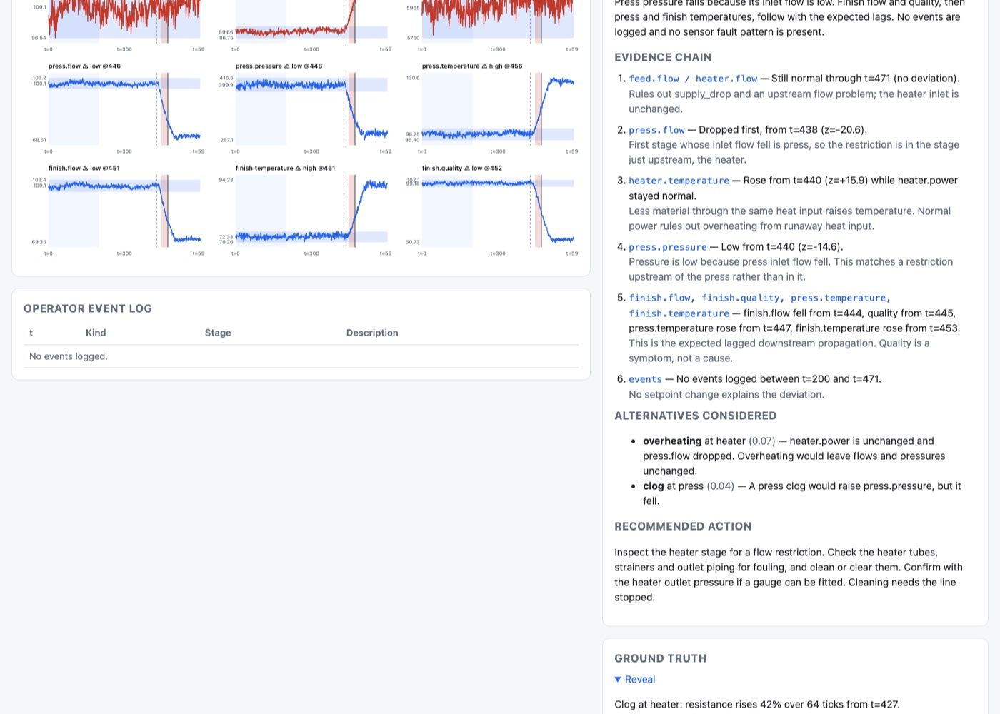
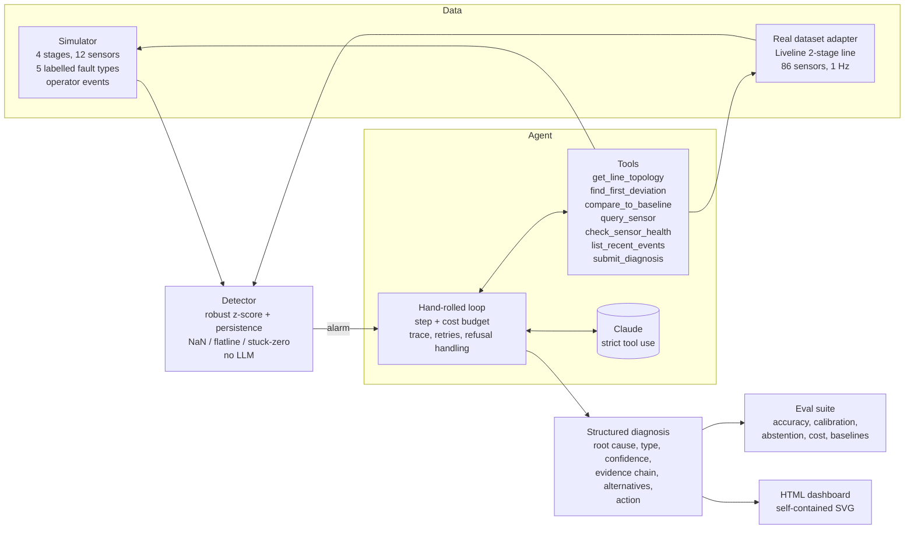

# Root-cause diagnosis agent for a multi-stage production line

An AI agent that watches sensor data from a sequential production line, gets woken up by a
cheap statistical detector when something looks off, and then traces the symptom back to the
stage that actually caused it, explaining the evidence chain in plain language for a
reliability engineer.

The hard part is not spotting the anomaly. It is that **the stage where the alarm fires is
usually not where the problem is.** A partial clog in the feed stage shows up first as a
starving press stage three hops downstream, and a threshold alert blames the press.



*A heater clog, diagnosed by the LLM agent. The alarm fired on `press.flow`, one stage
downstream. The agent traced it back: the press inlet flow fell while the heater inlet flow
stayed normal, so the restriction is inside the heater, confirmed by the heater running hot
with unchanged heat input and the press pressure falling rather than rising.*

## What is in the box



| Layer | What it does | Where |
|---|---|---|
| Simulator | Abstract but causal physics for feed → heater → press → finish, with transport lags and thermal inertia. Injects clog, overheating, supply drop, sensor drift, sensor failure, plus benign and distracting operator events. Ground truth is known. | `src/rootcause/sim` |
| Detector | Deterministic and cheap. Robust baseline (median/MAD) from a known-good window, EWMA-smoothed z-score with a persistence rule, and separate rules for missing, flatline and stuck-at-zero signals. Guards against channels that are legitimately constant. | `src/rootcause/detect` |
| Agent | A hand-rolled loop over the Anthropic Messages API with strict tools. Owns budgets (steps and dollars), token/cost accounting, a JSONL trace of every model and tool call, prompt caching, and the failure paths (refusal, truncation, model never submitting). | `src/rootcause/agent` |
| Evals | Balanced scenario suite with deliberately misleading cases. Scores root-cause accuracy, fault-type accuracy, calibration (Brier, ECE), abstention rate, confident-error rate, false positives on no-fault alarms, tool calls, tokens, cost and latency. Two non-LLM baselines for comparison. | `src/rootcause/evals` |
| Real data | Adapter for the public Liveline continuous-flow dataset (parallel machines feeding a combiner, then two machines in series). Labelled sensor faults are injected into the real series for a quantitative check. | `src/rootcause/realdata` |
| UI | One self-contained HTML file per diagnosis: all sensor traces with baseline band, alarm window and true onset, next to the diagnosis, evidence chain and the full agent trace. No server, no CDN. | `src/rootcause/ui` |

## Quickstart

```bash
make setup                      # installs uv if needed, then all dependencies
make demo                       # offline: misleading clog scenario, rule-based backend
```

With an Anthropic key (copy `.env.example` to `.env`, or export `ANTHROPIC_API_KEY`):

```bash
uv run rootcause diagnose --kind clog --seed 6 -v        # LLM agent, verbose trace
uv run rootcause eval --n 48 --backend anthropic         # full eval with the LLM column
uv run rootcause real-eval --n 20                        # injected faults on the real dataset
```

Every `diagnose` and `eval` run writes JSON results, a JSONL trace per diagnosis, and HTML
dashboards under `runs/`. Open `runs/<run>/index.html` for an eval, or the per-scenario
`.html` for a single diagnosis.

Other commands: `rootcause simulate` (one scenario to CSV), `rootcause suite` (the whole
suite to CSV), `rootcause real-diagnose` (a natural alarm in the real data), `rootcause
dashboard <run_dir>` (rebuild an index). `--help` on any of them.

## How the agent works

The detector hands the agent a report: which sensor alarmed first, every alarm confirmed so
far, and the current tick. The agent only sees data up to that tick (by default 25 ticks after
the alarm), so it is diagnosing a fault that is still developing, like a real engineer would.

The system prompt gives it a method rather than answers: fetch the topology, find which
signals moved and in what order, form two or three hypotheses that each explain the whole
pattern, then confirm or kill them with the physically coupled signals. The topology tool
describes the causal rules of the specific line (for the simulator: a clog raises its own
stage's pressure and starves the next stage; a supply drop lowers feed pressure; a sensor
fault moves exactly one signal), so the same prompt and tools work on the real line, which
has a different shape.

The diagnosis is itself a strict tool call (`submit_diagnosis`), validated against a pydantic
schema:

```
status                  fault_diagnosed | no_fault | insufficient_evidence
root_cause_stage        stage name or null
fault_type              clog | overheating | sensor_drift | sensor_failure | supply_drop | none
affected_sensor         for sensor faults
confidence              P(stage AND type are both right)
evidence[]              signal, observation with ticks and magnitudes, why it matters
alternative_hypotheses[] stage, type, confidence, why less likely
recommended_action      what to inspect, where
requires_downtime       bool
reasoning_summary       the causal chain in plain language
```

Production concerns the loop handles explicitly:

- **Budgets.** Max model calls and max dollars per diagnosis. When either is hit the agent gets
  one final, submit-only turn; if it still does not submit, the run is recorded as
  `budget_exhausted` with a synthesized `insufficient_evidence` result.
- **Observability.** Every model call (stop reason, latency, token usage, cost) and every tool
  call (input, output, error flag) lands in the trace. Cost is computed from a pricing table,
  including cache reads and writes.
- **Bad data.** Tools never raise into the model. Unknown stages, out-of-range windows and
  missing columns come back as `is_error` tool results the model can recover from. NaN, zero
  and flatlined sensors are first-class concepts in the detector and the tools.
- **Honest outcomes.** `insufficient_evidence` is a legitimate answer and is scored separately
  from wrong answers. The eval tracks confident errors (wrong at confidence ≥ 0.75) because a
  confidently wrong diagnosis costs more than an abstention.
- **API failure modes.** Refusals (`stop_reason: refusal`), truncation (`max_tokens`), a model
  that answers in prose instead of calling the tool, rate limits and connection errors all
  have explicit paths and end in a well-formed run record.
- **Prompt caching.** The system prompt and tool definitions are stable and marked cacheable;
  the volatile detector report comes after them.

## Evals

Three systems are scored on the same scenarios:

- **Naive**: blame the stage where the first alarm fired, guess the type from the signal.
  This is what a threshold-alert dashboard gives you.
- **Rule-based tracer**: a hand-written policy that drives the same tools through the same
  loop. It walks the topology upstream from the first flow deviation and checks coupled
  signals. It knows the simulator's physics, so it is a strong baseline there and a useless
  one anywhere else (it cannot run on the real line).
- **LLM agent**: Claude with the tools, no knowledge of the simulator beyond the topology
  tool.

Results on 48 scenarios (40 alarms), seed 0. The LLM agent is `claude-sonnet-5-5` at medium
effort; its full report with calibration bins and the per-scenario table is
[docs/eval-llm-report.md](docs/eval-llm-report.md), the offline baselines are in
[docs/eval-offline-report.md](docs/eval-offline-report.md):

| Metric | Naive | Rule-based tracer | LLM agent |
|---|---|---|---|
| Root-cause stage accuracy | 69.4% | 94.4% | 100.0% |
| Fault-type accuracy | 94.4% | 91.7% | 100.0% |
| Both correct | 63.9% | 91.7% | 100.0% |
| Both correct, **misleading cases only** (n=11) | **0.0%** | 100.0% | 100.0% |
| Abstained | 0.0% | 0.0% | 0.0% |
| Confident errors (wrong at confidence ≥ 0.75) | 0.0% | 5.0% | 0.0% |
| False positives on no-fault alarms | 100.0% | 0.0% | 0.0% |
| Brier score | 0.26 | 0.089 | 0.032 |
| Mean tool calls per diagnosis | 0 | 5.2 | 4.9 |
| Mean cost per diagnosis | – | – | $0.026 |
| p50 latency | – | – | 11.2 s |

Detector on the same suite: 0% false alarms on 6 normal runs, 100% detection on 36 faults,
median 17 ticks from fault onset to alarm, and 30.6% of alarms fire at a stage other than the
root cause.

Three things to read from this table. The naive approach is right about *what kind* of fault
it is most of the time and wrong about *where* in every misleading case, which is the failure
the project targets. The rule-based tracer shows that on a simulator whose physics you wrote,
a few rules go a long way; its weak spots are the ambiguous cases (overheating at a stage
with no power sensor, or with a distracting setpoint change logged at the same stage: 50%
correct) where judgment about magnitude is needed. And the LLM agent, which knows nothing
about the simulator beyond the topology tool, matches the tracer on the misleading clogs and
beats it on exactly those ambiguous cases, with no confident errors and a Brier score a third
of the tracer's, at about 2.5 cents and 11 seconds per diagnosis.

How the LLM column was produced, so the numbers are not oversold. The first run with the
untuned prompt scored 97.2% both-correct on seed 0: the single miss was an overheating fault
at the feed stage (which has no power sensor), called a sensor drift at confidence 0.65
because the downstream heater temperature was only "slightly elevated" and the prompt said a
sensor fault's coupled signals are "normal". The prompt was tuned on that one failure (a
sub-threshold coupled signal trending in the physically predicted direction is early
propagation, not noise; overheating at a stage without a power sensor is diagnosed from
temperature alone; spend one more tool call when confidence would be below 0.75). The change
was validated on seed 1, a different suite the prompt had never seen: 100% both-correct and
zero confident errors both before and after the change, so no regression, at one extra tool
call per diagnosis on average. Re-run on seed 0, the tuned prompt fixes the miss, now calling
overheating at 0.60 after checking the heater temperature's slope. One scenario separates
97.2% from 100%, and LLM sampling is not deterministic, so read the LLM column as "at or
near ceiling on this suite" rather than as a precise number. Across both seeds the agent is
mildly under-confident (ECE 0.17: 100% accuracy in the 0.8-1.0 bin at a mean confidence of
0.86), which is the safe side to err on for a diagnosis a human will act on.

## Real-data validation

The public **Multi-stage continuous-flow manufacturing process** dataset (Liveline
Technologies, via Kaggle, listed in awesome-industrial-datasets) is one ~4 hour run of a real
line at 1 Hz: three parallel machines feed a combiner, the product is measured at 15
locations, then passes through two more machines in series and is measured again.

The adapter resamples to 10-second ticks, renames the 85 non-constant channels to
`<stage>.<sensor>`, and declares the topology as a DAG with the causal notes the agent needs
(parallel machines do not affect each other, output measurements are symptoms not causes, raw
material properties change in steps at lot changes). The detector, tools, prompt and
dashboard run unchanged.

The dataset has no fault labels, so validation has two parts:

1. **Injected sensor faults** (`rootcause real-eval`): drift, NaN, flatline or zero injected
   into one real channel at a random time. Ground truth is exact, and the real background
   (drifts, lot changes, instrument artefacts: 49 natural alarms in this run) makes it
   genuinely hard to say "this one sensor is lying" rather than "the process changed".
2. **Natural alarms** (`rootcause real-diagnose --alarm N`): no labels, judged
   qualitatively on whether the evidence chain is consistent with the topology and whether the
   agent abstains when it should.

Results with `claude-sonnet-5-5` at medium effort (`rootcause real-eval --n 20`, seed 0,
2026-10-15). The detector caught 14 of the 20 injections (70%); the misses are drifts on
channels that had already alarmed naturally before the injection, or that stayed inside the
real noise. On the 14 alarms the agent was fully correct on 5 (36%), abstained on 6 (43%) and
wrong on 3 (21%), never above confidence 0.5, so zero confident errors; mean cost $0.052, twice
the simulator's, from the larger topology and the longer alarm report. The naive baseline
scores 100% here by construction: the harness scores each injection on the injected sensor's
own alarm and every injection is a sensor fault, so "blame the alarming sensor" is a ceiling
for this suite, not a competitor. The three errors were all "clog at the alarming machine" at
0.4 to 0.5: on a line with 85 sensors and 49 natural alarms in four hours, "one abnormal signal
with flat neighbours" is rarely cleanly true, and the agent reaches for a process fault. The
abstentions are the more interesting outcome: missing-data and stuck-zero injections on
raw-material lab-value channels, which the topology notes say change in steps at lot changes,
and which the agent declined to call either way. On the first natural alarm (`real-diagnose
--alarm 0`, a Stage1 output measurement at t=183) the agent abstained at 0.30 with a coherent
chain: four output measurements moved together and propagated to Stage2 after a lag, so a real
product change, but no cause visible in any upstream machine signal, and it suggested checking
for a material lot change. For an unlabelled run that is the right answer.

Building the adapter changed the detector: real controlled and lab-value channels sit exactly
constant for long stretches, which the first flatline rule read as 66 dead sensors. Flatline
and stuck-zero rules now apply only to sensors that vary during their own baseline.

The CSV is not redistributed (license unstated on Kaggle). Download it from the Kaggle dataset
`supergus/multistage-continuousflow-manufacturing-process` to
`data/real/continuous_factory_process.csv`.

## Design trade-offs

- **Hand-rolled loop instead of a framework.** The loop is ~350 lines and every production
  concern above lives in it, visibly. A framework would hide exactly the parts worth
  reviewing. The cost is that the SDK's tool runner would have saved the tool dispatch code.
- **Final answer as a strict tool, not structured output.** `submit_diagnosis` keeps the
  diagnosis in the same trace as the evidence gathering, lets the model keep investigating if
  the submission fails validation, and gives the loop a clean terminal condition. Structured
  output on the final message would have been simpler but harder to nudge.
- **Deterministic detector, LLM only on alarm.** Detection runs on every tick and must be
  cheap and explainable; the LLM runs tens of times a day, not thousands.
- **Flow meters at stage inlets.** The first simulator version put them at outlets, which made
  the clogged stage alarm first and the problem trivial. Inlet metering is what real lines
  usually have and is what produces the misleading downstream symptom.
- **Deliberately asymmetric sensor noise.** Pressure and power sensors are noisier than flow
  sensors, so a root-cause signal often crosses the alarm threshold *after* a quieter
  downstream signal. Ordering alone does not solve the problem; physics does.
- **Sonnet at medium effort by default.** The task is bounded and tool-heavy; the eval reports
  cost per diagnosis so the model and effort can be chosen on evidence. Both are flags.
- **Inline SVG dashboards, no Plotly.** A CDN script failed to load in a sandboxed viewer
  during development; a self-contained file that opens anywhere, including from `file://`,
  is worth more than hover tooltips.
- **Rule-based backend speaks the SDK's `Message` type.** The loop cannot tell it from the
  real API, so the whole pipeline, including budget exhaustion and error paths, is tested in
  CI without a key.

## Limitations and next steps

- The simulator suite is close to saturated for the LLM agent (100% on both seeds tried), so
  it no longer separates prompts. The next suite needs harder cases: compound faults, a
  fault during a setpoint transient, smaller severities and shorter grace windows, and
  scenarios where the honest answer is `insufficient_evidence` (the agent never abstained
  on the simulator, and the eval cannot yet tell whether that is right).
- Each eval number is one run of a sampled model. The seed-0 and seed-1 runs agree, but a
  confidence interval would need repeats, and the one-scenario difference between the
  untuned and tuned prompts is within sampling noise.
- The first real-data runs had the agent naming the right sensor and fault type and then
  writing `feed` or `finish` as the stage, because the diagnosis schema's field description
  listed the simulator's four stage names. The stage fields are now enums built from the
  line's topology, like the other tools' arguments. The lesson generalises: anything in a
  prompt or schema that quietly assumes one line's vocabulary will surface on the next line.
- The real-data injected-fault eval initially scored every injection against the run's
  first natural alarm (which fires before any injection), so the agent abstained on all 20
  and the numbers were meaningless. It now scores each injection on the injected sensor's
  own alarm episode, and counts injections the detector never catches as misses.
- The simulator's physics are abstract by design. Real lines have control loops that mask
  symptoms; the real-data adapter is where that shows up, and only sensor faults can be
  labelled there.
- Out of scope, per the brief: alert routing, manuals/RAG, plant integrations.

## Project layout

```
src/rootcause/
  sim/        topology.py (line model + causal rules), simulator.py, faults.py, scenarios.py, io.py
  detect/     detector.py
  agent/      loop.py, tools.py, schema.py, prompts.py, pricing.py, fake.py (rule-based backend)
  evals/      runner.py, metrics.py, baselines.py, report.py, types.py
  realdata/   adapter.py, inject.py, evaluate.py
  ui/         dashboard.py
  cli.py
tests/        30 tests, all offline
docs/         screenshot, offline eval report, LLM eval report
```
